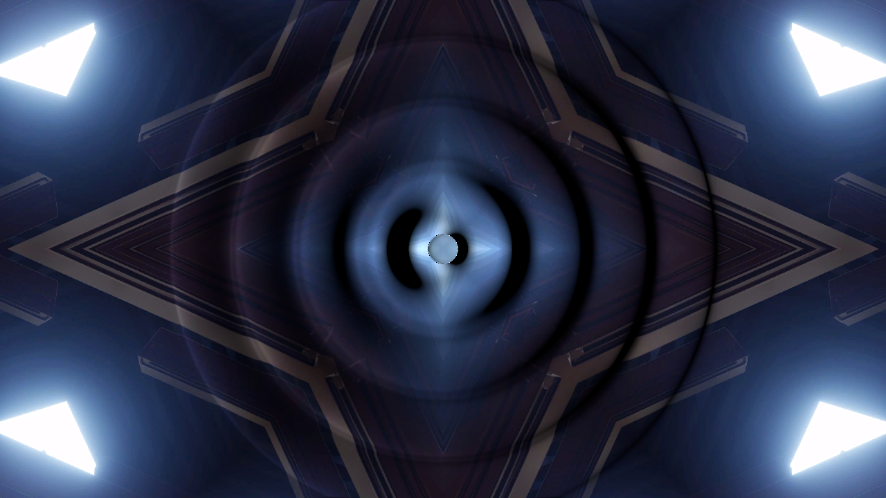

# schlieren

> **AI-assisted project.** This codebase was created with [Claude](https://claude.com/claude-code)
> (Anthropic), directed and reviewed by a human author. The behaviour is measured rather
> than asserted: an offline harness drives the real plugin class in a headless GL context
> and checks each claim. The pulse fronts sit at a + c t to under a pixel. The beam's
> projection of every pulse matches a brute-force line-of-sight integral to 2e-5. Shocks form
> where weak-shock theory says, and the steepened waveforms agree with an independent Godunov
> solver and with closed forms. Every optic obeys its law pixel by pixel, and a rigid wall
> mirrors the field exactly. 16 negative controls and 16 one-character mutants prove the
> checks can fail. It has **never been loaded into Resolume**, on either platform. See
> [Status](#status).

Pressure waves on the beat, seen through a schlieren camera, as an FFGL effect for
[Resolume](https://resolume.com) Arena and Avenue.



<sub>One frame, rendered by `sztest`, the offline harness, not captured from Resolume.
Resolume's bundled `IntoTheGlow_02` on the defaults at 120 BPM, 2.8 seconds in: five
beats' worth of pulses in flight, the oldest nearly at the frame's edge.</sub>

## The one idea

**A loudspeaker fires a pulse into the air on every beat, and you watch the clip
through that air.**

You can't see sound, but you can see what it does to light. A pressure wave squeezes
the air, squeezed air is denser, denser air has a slightly higher refractive index, and
light crossing it bends towards the dense side, by a few millionths of a radian. In 1864
August Toepler worked out that if you focus the light and put a knife edge where the
focus would be, those tiny bends turn into light and shade. That's a schlieren
photograph, and it's still how people take pictures of shock waves and gunshots.

So the plugin is the speaker, the air and the camera:

- **the speaker** is a 20 cm sphere firing a short pulse (a Pop, a Kick or a Blast) at
  the beat of Resolume's clock, or on onsets in the audio, or when you press Fire;
- **the air** carries it as a spherical sound wave, fading as 1/r. If it's loud, it
  steepens as it goes, because compressions travel slightly faster than sound and catch
  up with what's in front of them, until they become shocks;
- **the beam** sees the pressure integrated along its path, and is bent by its gradient
  in proportion to the Gladstone–Dale constant of air;
- **the optics** turn the bending into a picture: a knife edge, a colour filter, a
  shadow on a screen some distance away, or the clip seen as a backdrop through the air.

## What falls out

None of this is drawn. Each is the air or the optics doing what it does.

- **Rings on the beat.** Each one leaves the speaker at the moment the beat fell, placed
  inside the frame rather than snapped to it, and spreads at the speed of sound (slowed
  by the camera).
- **Light on one side, dark on the other.** A knife edge only catches bends towards it,
  so every ring is a raised band on one side and a trench on the other. Turn the knife
  and the lighting turns with it.
- **The way they fade.** A spherical pulse thins out as 1/r, but the beam crosses the
  whole shell, so on screen a ring fades as one over the square root of its radius.
- **Loud hits crack.** Push Loudness up, or shorten the pulse, and the fronts sharpen
  into shocks: a Pop becomes the N-wave you get from a gunshot, a Kick grows a sawtooth.
  With Accent and some audio, a hard hit is sharper than a soft one.
- **Echoes.** With Walls on Floor or Box, the frame's edges reflect. Each ring comes
  back off them, and the reflections cross each other.
- **Caustics.** With the Shadowgraph a screen's distance beyond, the bent light piles
  up into bright lines and leaves dark gaps, as light under a swimming pool does.

## Controls

| Group | |
| --- | --- |
| **Beat** | Fire On (Beat, Half Beat, 2 Beats, Bar, Onset, Off), Fire (a pulse now), Audio (Resolume's audio input), Threshold (how hard an onset must hit), Accent (0–30 dB: how much quieter the softest hit is than the hardest). |
| **Speaker** | Loudness (peak, 120–190 dB SPL at 1 m), Pulse (Pop, Kick, Blast), Length (0.05–20 ms, peak to trough), Speaker X, Speaker Y. |
| **Air** | Field Width (the frame, 0.5–50 m), Slow Motion (30–30 000×: the camera at 1 800 to 1 800 000 fps), Walls (Open, Floor, Box), Reflection (the walls' pressure reflection, 0–1), Clear (let every pulse go). |
| **Optics** | Optics (Knife Edge, Colour, Shadowgraph, Background), Knife Angle (0–360°), Sensitivity (the bend that takes the knife from grey to white, 50″ down to 0.05″), Distance (where the camera is focused, the screen is or the backdrop stands: 0, then 10 m to 100 km), Grey Field (mix in the bare schlieren field, so dark clips show rings too). |
| **Output** | View (Picture, Pressure, Deflection: the air on its own), Mix. |

The defaults are a starting pistol's crack, half a millisecond long at 165 dB, fired on
every beat from the middle of a 6 m stretch of air and filmed at 400×, through a knife
edge set to go white at 12 arcseconds and focused 150 m beyond the air.

Yes, 150 metres, and Distance goes to 100 km. Sound bends light by a few arcseconds,
so a pixel of warp needs a backdrop a long way off. Real background-oriented schlieren
uses distant hills, and NASA has photographed supersonic shocks against the desert
floor from a plane flying above them. The numbers in this plugin are what it takes,
not a dial turned up for effect.

## Status

**v0.1.0, local and unreleased, 13 October 2026.**

### Measured offline, on macOS

`tools/verify.sh` passes on this machine (Apple Silicon, macOS 26) against a fresh
universal Release build. It runs every picture check at **two rasters**, 1280×720 and
320×180, and again on **Apple's software renderer** at 320×180. What it establishes:

| check | result |
| --- | --- |
| `--air` | c = 343.2 m/s against √(γRT/M) = 343.23; ρ = 1.2040 against pM/RT = 1.2041; n − 1 = Kρ = 2.721e-4 against Edlén's standard air at 20 °C, 2.723e-4; 140 dB SPL = 200 Pa |
| `--steepen` | a Pop's shock forms between 0.95 s* and 1.1 s* of s* = 1/(κ P_a max f₀′); a top hat's shock within a cell of −L + √(2kLs) and its triangle within a cell's shift; an N-wave's length within a cell of L√(1 + 2ks/L); Pop, Kick and Blast within Godunov's own error of a 2400-cell Godunov solve |
| `--beat` | Beat, Half Beat, 2 Beats and Bar on the host's clock and the plugin's own: every pulse leaves within **6e-14 s** of its beat |
| `--abel` | Pop, Kick, Blast, a shocked Pop at 185 dB and a top hat: **0 of 2048** table texels outside their bound against a brute-force Gauss–Legendre line of sight (worst 2e-6 of the peak, 2e-4 at a Blast's shock front); the top hat's flat top is acosh to 3e-14 |
| `--field` | open air and a box of six images, both rasters: **0 of 14 651** sampled pixels outside their bound (worst 1.8e-5 of the peak) |
| `--speed` | at 0.69, 1.26 and 1.84 m the front lies between the last pixel that moved and the first that didn't, both rasters |
| `--spreading` | the steepest gradient at 2.8, 5.6 and 11.2 m falls as R^−0.522 (theory −0.5, tolerance 2w/R = 0.1) |
| `--knife` | knife at 0°, 90° and 210°, both rasters: **0 of 6180** pixels outside clamp(1 + ε·k/ε_c, 0, 2), hundreds of them at the clamp |
| `--colour` | the wheel passes the clear middle's light on average, opposite deflections are complementary and a 120° turn cycles the channels, at every sampled pixel |
| `--shadow` | the first-order law I/I₀ − 1 = −L∇·ε within its second-order bound everywhere; a screen that bends by a fifth keeps the frame's light to **1.000001** |
| `--background` | the backdrop seen displaced by L ε at 20 km, up to 76 px, within its bound at every sampled pixel (worst 0.18 px) |
| `--walls` | a rigid floor: the field either side of the edge **bit-identical**; a box's four walls to 5e-4 of 350 Pa m |
| `--audio` | six kicks, six pulses, each on its kick's frame, none from the cold start; Accent puts soft hits 12 dB under hard ones; with no audio every pulse is at Loudness |
| `--resize`, `--state` | a new raster is the same air (**0 bytes** differ); the host's GL state comes back |
| `--negative` | **16** deliberately wrong models, **16** caught |
| mutation | **16** one-character mutants of the shipped GLSL and C++, **16** caught |
| `tools/sweep.py` | all **21** controls measurably change the picture |
| shaders | all 4 compile through `glslc`, not merely through Apple's driver |
| the bundle | universal (`x86_64 arm64`), exports `plugMain`, ad-hoc signs; `oxbow` reports `SW Schlieren` / `SZ01` / `effect` and renders 120 frames through `plugMain` |

Render cost, GPU time by `GL_TIME_ELAPSED`, median of 120 frames after a warm-up, on a
GPU shared with other work, so the small numbers wobble from run to run: at the defaults
(120 BPM, about eleven pulses in flight), **0.43 ms** at 720p, **0.54 ms** at 1080p and
**1.91 ms** at 4K. Half Beat in a box of rigid walls with the shadowgraph, up to 107
images in flight: **0.60**, **1.10** and **4.04 ms**. macOS figures only.

### Not established

It has **never been loaded into Resolume**, on macOS or Windows, and it has never been
built for Windows. Everything above was compiled, rendered and measured offline
against the real plugin class in a headless CGL context, plus an `oxbow` load. How
the 21 controls read in Arena's inspector, how Fire On Beat follows Resolume's real
transport, and how Accent and Threshold behave on Resolume's real FFT are untested.

Weak-shock theory is honest up to about a third of an atmosphere at the speaker; past
roughly 170 dB at 1 m it's a good look rather than a prediction. Reflections are
superposed linearly, so shocks meeting their own echoes do nothing clever. AGENTS.md
lists every approximation.

No user guide yet, no browser demo, no OpenFX port.

## Build

macOS (universal: Apple Silicon and Intel):

```bash
git clone --recurse-submodules https://github.com/stoatworks-labs/schlieren
```

```bash
cmake -B build -DCMAKE_BUILD_TYPE=Release
```

```bash
cmake --build build
```

```bash
cmake --install build
```

The last one copies `Schlieren.bundle` into `~/Documents/Resolume Arena/Extra Effects`.
Restart Arena and it's under Effects as **SW Schlieren**.

Windows needs Visual Studio 2022 and vcpkg (for GLEW); see `.github/workflows/ci.yml`.

## Building and testing

```bash
tools/verify.sh
```

That's the whole lot: a fresh universal build, every check at two rasters and on the
software renderer, the negative controls, the mutants, the sweep for dead controls, the
bundle's architecture and plist, an ad-hoc signature, a host's view of it through
`oxbow`, and the render cost. `CLAUDE.md` lists the checks one by one.

Render a frame of your own:

```bash
./build/sztest --out /tmp/schlieren.png --set "Optics=Colour" --set "Grey Field=1"
```

## License

MIT. See [LICENSE](LICENSE) and [ATTRIBUTIONS.md](ATTRIBUTIONS.md).
